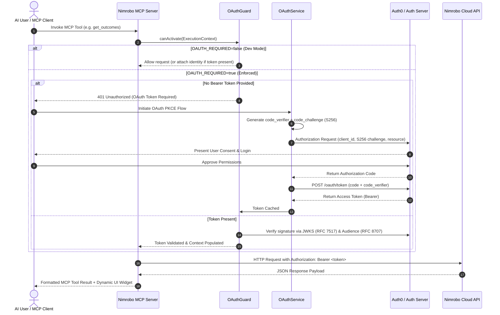
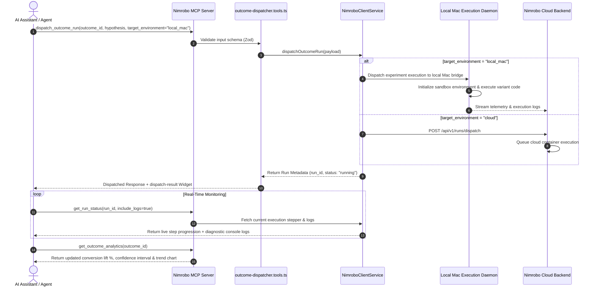

# Nimrobo AI MCP Server

[](https://nitrostack.ai)
[](https://modelcontextprotocol.io)
[-blue.svg)](https://datatracker.ietf.org/doc/html/rfc7636)
[](LICENSE)
[](#-testing--quality-assurance)

> **Enterprise Model Context Protocol (MCP) server for [Nimrobo AI](https://nimroboai.com)**, empowering AI assistants (Claude Desktop, Cursor, ChatGPT, NitroStudio, and Autonomous AI Agents) to query real-time **Outcome Analytics**, inspect conversion lifts, and securely dispatch **Outcome Experiment Runs** directly on local macOS environments or cloud runners. Built with the **NitroStack Framework (`@nitrostack/core`)**.

---

## 📑 Table of Contents

- [🏛️ System Architecture](#️-system-architecture)
  - [High-Level Architecture](#high-level-architecture)
  - [Component Architecture Breakdown](#component-architecture-breakdown)
  - [OAuth 2.1 PKCE Authentication Flow](#oauth-21-pkce-authentication-flow)
  - [Outcome Run Execution Lifecycle](#outcome-run-execution-lifecycle)
- [🌟 Capabilities & Features](#-capabilities--features)
- [🛠️ MCP Protocol Specification](#️-mcp-protocol-specification)
  - [Tools (Action Interface)](#1-tools-action-interface)
  - [Resources (Context & State Interface)](#2-resources-context--state-interface)
  - [Prompts (Assisted Workflows)](#3-prompts-assisted-workflows)
- [🖼️ Interactive MCP Widgets (UI Components)](#️-interactive-mcp-widgets-ui-components)
- [📁 Project Structure](#-project-structure)
- [⚙️ Configuration & Environment Variables](#️-configuration--environment-variables)
- [🚀 Quick Start & Installation](#-quick-start--installation)
- [🔌 MCP Client Configuration](#-mcp-client-configuration)
  - [Claude Desktop](#claude-desktop)
  - [Cursor IDE](#cursor-ide)
  - [NitroStudio (Visual Testing & OAuth Playground)](#nitrostudio-visual-testing--oauth-playground)
- [🧪 Testing & Quality Assurance](#-testing--quality-assurance)
- [📜 License](#-license)

---

## 🏛️ System Architecture

### High-Level Architecture

The Nimrobo MCP Server serves as the central control and data intelligence plane between **LLM Clients / AI Agents**, the **Nimrobo Cloud Platform**, and the **Local macOS Execution Daemon**.

```mermaid
flowchart TB
    subgraph ClientLayer["AI Client & Agent Layer"]
        Claude["Claude Desktop"]
        Cursor["Cursor IDE"]
        Studio["NitroStudio / Web"]
        Agents["Autonomous AI Agents"]
    end

    subgraph NitroRuntime["Nimrobo MCP Server (@nitrostack/core Runtime)"]
        direction TB
        
        subgraph TransportLayer["Transport & Protocol Layer"]
            StdioTransport["Stdio Transport"]
            HttpTransport["HTTP / SSE Transport (Port 3000/3005)"]
            ProtocolDispatcher["MCP Protocol Dispatcher"]
        end

        subgraph SecuritySubsystem["Security & Auth Subsystem"]
            ConfigValidation["Zod Fail-Fast Config Loader"]
            OAuthGuard["OAuthGuard (RFC 8707 / RFC 7517)"]
            PKCEService["PKCE S256 Service (RFC 7636)"]
        end

        subgraph McpModule["Nimrobo Feature Module"]
            Tools["MCP Tools (6 Tools)\n• Analytics • Catalog • Runs • Dispatch"]
            Resources["MCP Resources (2 Resources)\n• nimrobo://outcomes/catalog\n• nimrobo://user/profile"]
            Prompts["MCP Prompts (2 Prompts)\n• analyze_outcome_performance\n• plan_outcome_experiment"]
            HealthCheck["System Health Provider (health://checks)"]
        end

        subgraph WidgetsLayer["MCP UI Widgets (Next.js Static Bundle)"]
            W_Profile["user-profile"]
            W_Catalog["outcomes-catalog"]
            W_Analytics["outcome-analytics"]
            W_Runs["outcome-runs"]
            W_Status["run-status"]
            W_Dispatch["dispatch-result"]
        end

        subgraph ServiceLayer["Service & Integration Layer"]
            NimroboClient["NimroboClientService (Axios + Interceptors)"]
            MockFixture["Offline Mock Sandbox Fixtures"]
        end
    end

    subgraph ExternalServices["External Infrastructure & Targets"]
        Auth0["Auth Server / Auth0 (OAuth 2.1 / JWKS)"]
        NimroboCloud["Nimrobo Cloud API (https://app.nimroboai.com)"]
        MacBridge["Local Mac Execution Bridge / Daemon"]
    end

    %% Client to Transport
    Claude -->|MCP JSON-RPC over Stdio| StdioTransport
    Cursor -->|MCP JSON-RPC over Stdio| StdioTransport
    Studio -->|MCP JSON-RPC over HTTP/SSE| HttpTransport
    Agents -->|MCP Protocol| ProtocolDispatcher

    StdioTransport --> ProtocolDispatcher
    HttpTransport --> ProtocolDispatcher

    %% Protocol to Security & Module
    ProtocolDispatcher --> ConfigValidation
    ProtocolDispatcher --> OAuthGuard
    OAuthGuard --> PKCEService
    PKCEService <-->|Token Exchange & JWKS Verify| Auth0

    ProtocolDispatcher --> McpModule
    McpModule --> Tools
    McpModule --> Resources
    McpModule --> Prompts
    McpModule --> HealthCheck

    %% Tool Widget bindings
    Tools -.->|Auto-registered UI| WidgetsLayer
    WidgetsLayer -.->|Embedded HTML/React| Studio

    %% Module to Services
    Tools --> NimroboClient
    Resources --> NimroboClient
    Prompts --> NimroboClient
    
    NimroboClient -->|Live API Requests (Bearer Auth)| NimroboCloud
    NimroboClient -.->|Fallback (NIMROBO_MOCK_MODE=true)| MockFixture
    NimroboClient -->|Local Experiment Dispatch| MacBridge
```

---

### Component Architecture Breakdown

| Component | Technology / Decorator | Responsibility |
| :--- | :--- | :--- |
| **MCP Bootstrap & Server Engine** | `@McpApp`, `McpApplicationFactory` | Initializes dependency injection container, handles lifecycle hooks, registers MCP tools, resources, prompts, and configures stdio/HTTP transports. |
| **Fail-Fast Configuration Engine** | `Zod`, `nimrobo.config.ts` | Validates environment variables upon startup. Rejects invalid formats (URIs, scopes, ports) immediately to prevent runtime misconfigurations. |
| **OAuth 2.1 PKCE Subsystem** | `OAuthModule`, `OAuthGuard`, `pkce.utils.ts` | Enforces RFC 7636 PKCE with `S256` SHA-256 code challenge generation, RFC 8707 Resource Indicators, and RFC 7517 JWKS cryptographic token validation. |
| **Outcome Analytics Tools** | `@Tool`, `outcome-analytics.tools.ts` | Implements Phase 1 tools (`get_user_profile`, `get_outcomes`, `get_outcome_analytics`, `get_outcome_runs`, `get_run_status`) with Zod input validation schemas. |
| **Outcome Dispatcher Tools** | `@Tool`, `outcome-dispatcher.tools.ts` | Implements Phase 2 experiment dispatcher (`dispatch_outcome_run`), routing runs to local Mac execution daemons or cloud runners. |
| **MCP Resource Providers** | `@Resource`, `nimrobo.resources.ts` | Exposes dynamic application state as read-only MCP resources (`nimrobo://outcomes/catalog`, `nimrobo://user/profile`). |
| **MCP Prompt Templates** | `@Prompt`, `nimrobo.prompts.ts` | Provides structured LLM prompt workflows (`analyze_outcome_performance`, `plan_outcome_experiment`) to guide agents through hypothesis generation. |
| **Interactive UI Widgets** | `@Widget`, Next.js static export | Delivers interactive visual components (charts, stepper logs, tables) rendered directly in MCP clients supporting `@modelcontextprotocol/ext-apps`. |
| **Nimrobo Client Service** | `NimroboClientService` | Encapsulates HTTP communication with Nimrobo Cloud (`/api/v1/*`), handles Bearer auth headers, response schema parsing, and offline mock fallback. |

---

### OAuth 2.1 PKCE Authentication Flow



---

### Outcome Run Execution Lifecycle



---

## 🌟 Capabilities & Features

### 📊 Phase 1: Outcome Analytics & Catalog (Cloud Intelligence)
* **`get_user_profile`**: Fetches user identity, organization context, active plan, and OAuth security state.
* **`get_outcomes`**: Lists and filters all business outcomes, baseline metrics, target KPI goals, and tags.
* **`get_outcome_analytics`**: Computes relative conversion lifts, confidence intervals, statistical significance, and timeline data.
* **`get_outcome_runs`**: Retrieves historical experiment runs, tested hypotheses, duration, and metric comparisons.
* **`get_run_status`**: Provides real-time execution step progression, status codes, and streaming diagnostic logs.

### 🚀 Phase 2: Local Mac & Cloud Outcome Run Dispatcher
* **`dispatch_outcome_run`**: Dispatches optimization experiment runs directly to the local macOS execution daemon (`local_mac`) or cloud runner (`cloud`).
* **Dry-Run Validation**: Supports `dry_run: true` mode to safely validate experiment parameters, preconditions, and schemas without mutating live assets.

### 🔐 Enterprise OAuth 2.1 & Security Architecture
* **Strict PKCE S256**: RFC 7636 compliant SHA-256 base64url challenge (plain method disabled).
* **Resource Binding (RFC 8707)**: Strict audience verification (`RESOURCE_URI`) preventing token forwarding.
* **JWKS Cryptographic Verification (RFC 7517)**: Asymmetric public key validation via Auth0/custom identity providers.
* **Fail-Fast Configuration**: Zod schema validates all environment variables at startup.
* **Offline Mock Sandbox**: Zero-dependency offline mode (`NIMROBO_MOCK_MODE=true`) for local agent testing and CI pipelines.

---

## 🛠️ MCP Protocol Specification

### 1. Tools (Action Interface)

| Tool Name | Parameters | Returns | Description |
| :--- | :--- | :--- | :--- |
| **`get_user_profile`** | _None_ | `UserProfile` | Fetches authenticated user profile, organization, and account details (`GET /api/v1/user/profile`). |
| **`get_outcomes`** | `status` _(optional: active\|paused\|archived\|draft)_<br>`tag` _(optional: string)_<br>`limit` _(optional: number, default: 20)_ | `Outcome[]` | Lists optimization outcomes with baseline and current metric values (`GET /api/v1/outcomes`). |
| **`get_outcome_analytics`** | `outcome_id` _(required: string)_<br>`time_range` _(optional: 7d\|30d\|90d\|all, default: 30d)_<br>`metrics` _(optional: string[])_ | `OutcomeAnalytics` | Returns detailed performance lift %, confidence levels, sample sizes, and timeline series. |
| **`get_outcome_runs`** | `outcome_id` _(optional: string)_<br>`status` _(optional: pending\|running\|completed\|failed\|cancelled)_<br>`limit` _(optional: number, default: 10)_ | `OutcomeRun[]` | Lists historical experiment executions, hypotheses, and measured metric delta. |
| **`get_run_status`** | `run_id` _(required: string)_<br>`include_logs` _(optional: boolean, default: true)_ | `OutcomeRun` | Retrieves real-time execution step progression and diagnostic console logs. |
| **`dispatch_outcome_run`** | `outcome_id` _(required: string)_<br>`hypothesis` _(optional: string)_<br>`parameters` _(optional: Record<string, any>)_<br>`target_environment` _(optional: local_mac\|cloud, default: local_mac)_<br>`dry_run` _(optional: boolean, default: false)_ | `OutcomeRun` | Dispatches a new outcome experiment run to local Mac bridge or cloud environment. |

---

### 2. Resources (Context & State Interface)

| Resource URI | MIME Type | Description |
| :--- | :--- | :--- |
| **`nimrobo://outcomes/catalog`** | `application/json` | Real-time JSON catalog of all configured optimization outcomes, targets, baseline values, and current metrics. |
| **`nimrobo://user/profile`** | `application/json` | Real-time authenticated user identity, role, and organization context. |
| **`health://checks`** | `application/json` | System health check reporting memory usage, uptime, and MCP server availability. |

---

### 3. Prompts (Assisted Workflows)

| Prompt Name | Arguments | Description |
| :--- | :--- | :--- |
| **`analyze_outcome_performance`** | `outcome_id` _(required)_<br>`time_range` _(optional)_ | Generates an executive performance report analyzing baseline vs. current lifts, statistical significance, and next-step recommendations. |
| **`plan_outcome_experiment`** | `outcome_id` _(required)_<br>`optimization_goal` _(required)_ | Structures a formal experiment hypothesis, observation duration, cohort parameters, and ready-to-dispatch payload. |

---

## 🖼️ Interactive MCP Widgets (UI Components)

The server includes pre-built, static-exported Next.js visual widgets that automatically render inside clients supporting the MCP Apps Extension:

```
src/widgets/app/
├── user-profile/       # User card, enterprise plan badge, security status
├── outcomes-catalog/   # Interactive outcomes list with metric lift indicators
├── outcome-analytics/  # Conversion lift gauge, statistical confidence, timeline chart
├── outcome-runs/       # Historical experiment feed with before/after comparisons
├── run-status/         # Step progression stepper & real-time terminal log viewer
└── dispatch-result/    # Run confirmation card with target environment indicator
```

---

## 📁 Project Structure

```
nimroboai-mcp-server/
├── src/
│   ├── index.ts                         # Bootstrap entry point & server launcher
│   ├── app.module.ts                    # Root @McpApp application module definition
│   ├── config/
│   │   └── nimrobo.config.ts            # Fail-fast Zod environment loader & validator
│   ├── auth/
│   │   └── pkce.utils.ts                # RFC 7636 PKCE S256 challenge generator & validator
│   ├── services/
│   │   ├── oauth.service.ts             # OAuth 2.1 PKCE authorization & token manager
│   │   └── nimrobo-client.service.ts    # HTTP client for Nimrobo Cloud endpoints
│   ├── guards/
│   │   └── oauth.guard.ts               # NitroStack OAuthGuard with audience verification
│   ├── health/
│   │   └── system.health.ts             # System resource health check provider
│   ├── modules/
│   │   └── nimrobo/
│   │       ├── nimrobo.module.ts        # Main feature module wiring tools & services
│   │       ├── outcome-analytics.tools.ts # Phase 1 MCP tools (@Tool)
│   │       ├── outcome-dispatcher.tools.ts# Phase 2 MCP tools (@Tool)
│   │       ├── nimrobo.prompts.ts       # MCP Prompts (@Prompt)
│   │       ├── nimrobo.resources.ts     # MCP Resources (@Resource)
│   │       ├── dto/                     # Zod input & output data transfer schemas
│   │       │   ├── auth.dto.ts
│   │       │   ├── outcome.dto.ts
│   │       │   └── index.ts
│   │       └── mocks/                   # Realistic offline mock fixtures
│   │           └── mock-data.ts
│   └── widgets/                         # Next.js interactive UI widgets bundle
│       ├── widget-manifest.json         # MCP widget manifest metadata
│       └── app/                         # Widget React/Next.js source components
├── tests/
│   ├── config.test.ts                   # Environment validation & fail-fast test suite
│   ├── pkce.test.ts                     # PKCE S256 generation & verification tests
│   ├── nimrobo-client.test.ts           # API client, interceptor & mock tests
│   └── tools.test.ts                    # MCP tool registration, prompts & guard tests
├── OAUTH_SETUP.md                       # Comprehensive Auth0 & OAuth 2.1 setup guide
├── package.json
├── tsconfig.json
├── vitest.config.ts
└── .env.example
```

---

## ⚙️ Configuration & Environment Variables

Create a `.env` file from `.env.example`:

```bash
cp .env.example .env
```

| Variable | Type | Default | Description |
| :--- | :--- | :--- | :--- |
| `RESOURCE_URI` | `string (URL)` | _Required_ | Protected resource identifier (e.g. `https://your-server.nitrocloud.ai/mcp` or `https://mcplocal`). Must match OAuth API audience. |
| `AUTH_SERVER_URL` | `string (URL)` | _Required_ | Authorization server domain (e.g. `https://dev-abc123.us.auth0.com`). |
| `OAUTH_REQUIRED` | `boolean` | `false` | When `true`, enforces strict OAuth token verification (fail-closed). When `false`, permits development/testing access. |
| `JWKS_URI` | `string (URL)` | _Optional_ | Cryptographic JWKS URI for asymmetric RS256 token verification. |
| `TOKEN_AUDIENCE` | `string` | `RESOURCE_URI` | Expected audience (`aud`) claim in access tokens. |
| `TOKEN_ISSUER` | `string` | `AUTH_SERVER_URL` | Expected issuer (`iss`) claim in access tokens. |
| `OAUTH_ENABLE_CLIENT_REGISTRATION` | `boolean` | `false` | Enables dynamic client registration endpoint (`/oauth/v2/register`). |
| `OAUTH_CLIENT_ID` | `string` | _Optional_ | Static OAuth client ID. |
| `OAUTH_CLIENT_SECRET` | `string` | _Optional_ | Static OAuth client secret (for confidential clients). |
| `NIMROBO_API_BASE_URL` | `string (URL)` | `https://app.nimroboai.com` | Base URL for Nimrobo Cloud API endpoints. |
| `NIMROBO_REDIRECT_URI` | `string (URL)` | `https://mcp.nitrostack.dev/oauth/callback` | OAuth redirect callback URL. |
| `NIMROBO_SCOPE` | `string` | `user:read` | Requested OAuth scopes. |
| `NIMROBO_ACCESS_TOKEN` | `string` | _Optional_ | Direct Bearer token for headless or CI/CD execution. |
| `NIMROBO_MOCK_MODE` | `boolean` | `true` | Enables offline mock fixture fallback when cloud endpoints are unreachable. |

---

## 🚀 Quick Start & Installation

### 1. Prerequisites
* **Node.js**: v18.0.0 or higher
* **npm**: v9.0.0 or higher

### 2. Install Dependencies
```bash
npm install
```

### 3. Configure Environment
```bash
cp .env.example .env
# Edit .env with your configuration
```

### 4. Run Test Suite
```bash
npm test
```

### 5. Build Project
```bash
npm run build
```

### 6. Start MCP Server
```bash
# Production mode
npm start

# Development mode with hot-reload
npm run dev
```

---

## 🔌 MCP Client Configuration

### Claude Desktop

Add to `~/Library/Application Support/Claude/claude_desktop_config.json` (macOS):

```json
{
  "mcpServers": {
    "nimrobo": {
      "command": "node",
      "args": [
        "/absolute/path/to/nimroboai-mcp-server/dist/index.js"
      ],
      "env": {
        "RESOURCE_URI": "https://mcplocal",
        "AUTH_SERVER_URL": "https://your-tenant.us.auth0.com",
        "NIMROBO_MOCK_MODE": "true",
        "OAUTH_REQUIRED": "false"
      }
    }
  }
}
```

---

### Cursor IDE

Add to `.cursor/mcp.json` in your workspace:

```json
{
  "mcpServers": {
    "nimrobo": {
      "command": "node",
      "args": [
        "/absolute/path/to/nimroboai-mcp-server/dist/index.js"
      ],
      "env": {
        "RESOURCE_URI": "https://mcplocal",
        "AUTH_SERVER_URL": "https://your-tenant.us.auth0.com",
        "NIMROBO_MOCK_MODE": "true"
      }
    }
  }
}
```

---

### NitroStudio (Visual Testing & OAuth Playground)

1. Open [NitroStudio](https://nitrostack.ai/studio).
2. Select the `nimroboai-mcp-server` directory.
3. Test MCP tools, inspect live Next.js widgets, trigger prompts, and verify the OAuth 2.1 PKCE interactive authentication tab.

For step-by-step Auth0 and production OAuth configuration, see [OAUTH_SETUP.md](OAUTH_SETUP.md).

---

## 🧪 Testing & Quality Assurance

The server includes a comprehensive Vitest test suite validating fail-fast configuration loading, PKCE cryptographic challenge math, API error handling, and MCP tool discovery:

```bash
# Run all unit and integration tests
npm test

# Run tests in watch mode
npm run test:watch
```

### Test Coverage Highlights
* **Config Loader Tests**: Validates Zod fail-fast schema, required URL format checks, and default fallbacks.
* **PKCE S256 Tests**: Validates cryptographic random verifier entropy (43-128 chars), SHA-256 base64url challenge hashing, and challenge verification.
* **Nimrobo Client Tests**: Verifies Bearer token interceptor injection, mock mode data resolution, and HTTP error normalization (401, 403, 404).
* **MCP Capabilities & Widget Binding Tests**: Validates `McpApplicationFactory` bootstrapping, tool registration, prompt resolution, and widget manifest discovery.

---

## 📜 License

This project is licensed under the **Apache-2.0 License** - see the [LICENSE](LICENSE) file for details.
